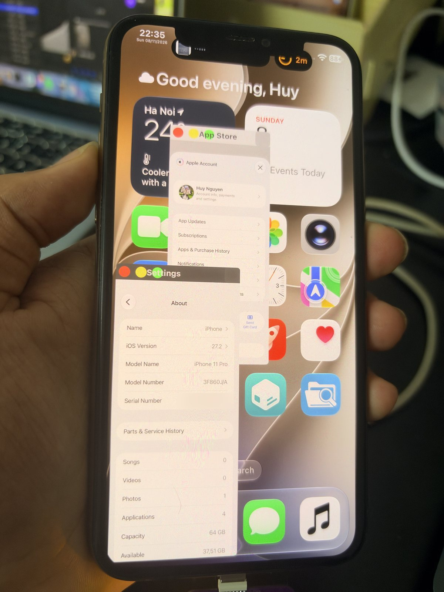
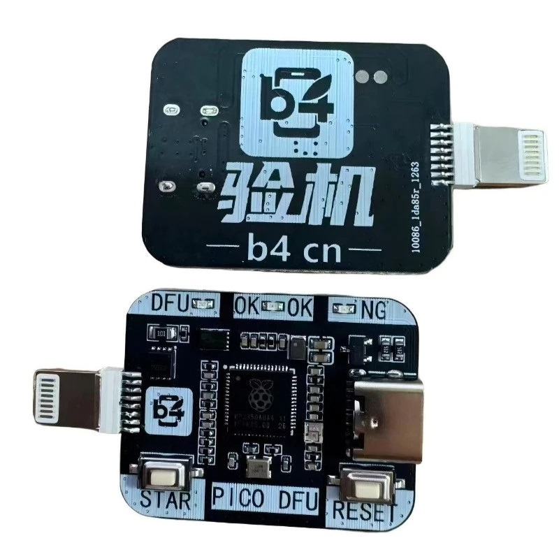

# doublera1n: jailbreak your iPhone 11/SE2 by using a new data volume

> [!CAUTION]
> CURRENTLY SUPPORTS iOS: 27.0-27.2 ON MAIN OS

doublera1n runs the phone's own stock System volume (sealed, untouched) with a separated data volume, as `/private/var`. It is booted from pwned DFU (usbliter8) with a patched kernel/iBoot and comes with a rootless jailbreak.

Stock iOS still here. A normal reboot on jailbreak data volume send you to stock iOS, to boot into the jailbreak state again, put the phone into pwned DFU and run `boot.sh`.

This resolve 2 problems I faced while using CFW: storage (which dualboot eats a lot) and cfw (which reboot turns your device into recovery mode).

But this is not a great solution, since SEP is disable for 2nd data partition, you can't login into iCloud on this, but luckily, FairPlay still works, which means application works well.

<p align="center">
  
</p>

## Quick start
```
git clone https://github.com/34306/doublera1n.git
cd doublera1n
./setup.sh        # auto setup environment
./dualboot.sh     # menu: ↑/↓ select, Enter run
./boot.sh         # boot jailbreak data volume (phone in pwned DFU)
```
On first use both scripts run `./setup.sh`, which installs the Homebrew tools (libimobiledevice, libirecovery, ldid, libusb, ipsw) and creates `.venv` from `requirements.txt`. `.venv/` is machine-local, run `./setup.sh` again any time to repair it (if needed).

| Menu | What it does |
|---|---|
| Boot 2nd Data | sends the prebuilt boot chain and waits for 2nd Data (SSH) |
| Select iOS version | the iOS build installed on the phone, followed by a pre-check |
| Install 2nd Data | only when there is no DataB yet: setup ramdisk creates DataB, blah blah... |
| Re-apply fixes | pushes every userland fix again over SSH (2nd Data running) |
| SSH into 2nd Data | `ssh root@` through iproxy (pinned to the phone's UDID) |
| Remove 2nd Data | deletes DataB and our files in Preboot, back to a single stock OS |

> [!WARNING]
> When setting up 2nd Data, if the iPhone asks **iPhone Partially Set Up**, choose **Continue with Partial Setup**. Do NOT choose **Erase and Start Over**.

I also fixed a lot of problems such as Wifi did not auto connect when reboot, deep sleep panic the device, SEP-less panic stuff, etc. You can check patches i did in the repo as well.

## Requirements
- A Mac (Apple silicon) with Homebrew. `setup.sh` installs libimobiledevice, libirecovery, ldid, libusb, [ipsw](https://github.com/blacktop/ipsw) and creates `.venv`.
- A usbliter8 board (RP2350) for pwned DFU. I'd recommend using the board i put the image below.
- A13: iPhone SE 2 (iPhone12,8, d79ap), iPad 9 Wi-Fi / Cellular (iPad12,1 j181ap / iPad12,2 j182ap), for iPad 9: added support but untested.
- Any iOS 27.x build of that iPhone. 2nd Data always runs the build installed on the phone (i might be extend to iOS 26 soon?).

## Untested iOS version

Every patch site is found again in the IPSW of the build you pick. If Apple changes a patched function too much, wait for me until I update and support it. Only iPhone 11 Pro on 27.2 (24B119) has booted so far, Issues, PR are welcome if it broken for you.

**Pre-check** (`lib/precheck.py`) runs before anything touches the phone: it pulls only BuildManifest, kernelcache, TXM, iBSS, iBEC and DeviceTree (~70 MB) with `ipsw extract --remote`, builds the profile, applies every patch and checks TSS. Release builds come from ipsw.me, betas and RCs from AppleDB. If your build is on neither, give the IPSW yourself (file or URL).

```
./dualboot.py versions                                   # local profiles + Apple's builds
./dualboot.py select --auto                              # read the build from the iPhone (USB)
./dualboot.py select --build 24B5110a                    # any build, betas included
./dualboot.py precheck --build <build> --ipsw <file|URL> # an IPSW you fetched yourself
```

TSS: if Apple doesn't sign the build anymore (old builds, betas), the newest signed build's ticket is used for the setup chain, the patched iBoot doesn't check AP images. Once installed, 2nd Data uses the ticket installed on the phone (read over UART), this UART require you to have this kind of board:



## Credits
- [usbliter8-fun by wh1te4ever](https://github.com/wh1te4ever/usbliter8-fun)
- [usbliter8]() (got deleted)
- [Liter8 by Xplo8E](https://github.com/Xplo8E/Liter8)
- [lycorine by hrtowii](https://github.com/hrtowii/lycorine-public)

## License
doublera1n is MIT, see [LICENSE](LICENSE). Some parts keep their own license.
